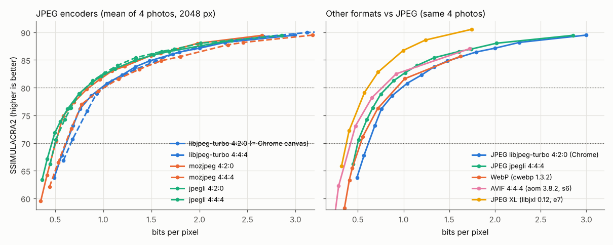
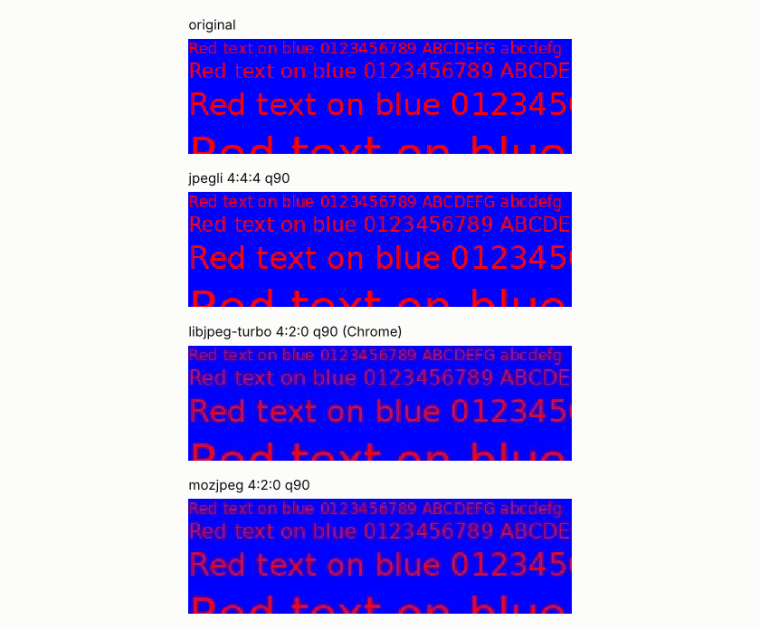

# JPEG encoder benchmark (and PNG / TIFF / other formats)

Research note for the LightBench export module. Every number here was measured in this session, unless it is cited from a primary source. Items that could not be measured are listed in [§10](#10-what-could-not-be-measured). Measured on 2026-10-11.

**Short answer:**
- **Encoder:** use **jpegli compiled to WebAssembly**, run in a Worker.
- **Defaults:** quality 90 with 4:4:4 chroma (4:2:0 below quality 80).
- **Dither:** don't dither JPEGs. Do dither 8-bit PNG and TIFF.
- **Export modes:** offer "limit file size" now. Hold "target perceptual quality" back.
- **PNG:** use `CompressionStream('deflate')` with adaptive filters. Avoid canvas PNG.
- **TIFF:** Deflate with the horizontal predictor.
- **Extra formats:** add AVIF next. Add JPEG XL once Safari and Edge support it fully. Skip WebP.

---

## 1. Method

### Machine and runtimes

| Item | Value |
|---|---|
| CPU | Intel Xeon @ 2.10 GHz, 4 vCPU (no GPU), 15 GB RAM, Linux 6.18 |
| Browser | Playwright headless Chromium **141.0.7390.37**. WebGPU runs on SwiftShader, which only matters for rendering the test images. Encoders run on the CPU. |
| Node | v22.22.0 |
| Python | 3.13.16, numpy 2.5.3, scipy 1.18.1, Pillow 12.3.0, tifffile 2026.9.20, imagecodecs 2026.10.10 (libdeflate 1.26), rawpy 0.27.1 (LibRaw 0.22.1), pyoxipng 9.1.1, zlib 1.3 |

**All timings are single-threaded** unless stated otherwise. They are the best or median of 2–5 repetitions. Because the machine is a shared cloud VM, treat them as relative, not absolute. A desktop CPU will be faster.

### Encoders

**mozjpeg (WebAssembly):** npm [`@jsquash/jpeg` 1.6.0](https://www.npmjs.com/package/@jsquash/jpeg).
- **Licence:** the wrapper is Apache-2.0. The codec is under the IJG, BSD-3 and zlib licences (`codec/LICENSE.codec.md`).
- **Build:** its [Makefile](https://github.com/jamsinclair/jSquash/blob/main/packages/jpeg/codec/Makefile) builds **mozjpeg v3.3.1** with `--without-simd` under Emscripten 3.1.57.

**mozjpeg (native):** 4.1.5, built from the `v4.1.5` tag with SIMD on.
- For the settings used here, its output is **byte-identical** to the jSquash WASM output. This was checked at q85 4:2:0 and q90 4:4:4.

**jpegli:** from [google/jpegli](https://github.com/google/jpegli) at commit `031a0077` (2026-06-01). Licence: BSD-3-Clause plus a patent grant (`LICENSE`, `PATENTS`).
- **Native build:** gcc, AVX2. Provides `cjpegli` and `ssimulacra2`.
- **Own WASM build:** Emscripten 4.0.10 with `-msimd128`, single-threaded (`build-wasm/tools/cjpegli.js`).
- **Third-party WASM package:** npm [`@winrisef/jpegli-wasm` 0.1.0](https://www.npmjs.com/package/@winrisef/jpegli-wasm), published 2026-09-15. The wrapper is MIT; its notices say it pins the same commit and Emscripten 4.0.10.
  - **Its output is byte-identical to my own Emscripten build** (d80 2048 px, distance 1.0).
  - The native AVX2 build matched both byte for byte on the a6300 image. On the d80 image it differed by 1 byte out of 427 157.
- **jpegli is no longer in libjxl.** libjxl 0.12.0 removed it: "*The `jpegli` codebase has been removed as it is now maintained as a separate project at google/jpegli (#4657)*" (libjxl `CHANGELOG.md`, 0.12.0, 2026-07-01).

**libjpeg-turbo:** `cjpeg` and `djpeg` **2.1.5** (Ubuntu noble package `libjpeg-turbo-progs`), run with `-optimize`.

**Browser built-in encoder:** `OffscreenCanvas.convertToBlob({type:'image/jpeg', quality})` in Chromium 141.

**Other formats:**
- cwebp **1.3.2**;
- avifenc **1.0.4** (aom 3.8.2), speed 6;
- cjxl and djxl from libjxl **0.12.0**, effort 7;
- jSquash `@jsquash/webp` 1.5.0, `@jsquash/avif` 2.1.1 (libavif 1.0.1, aom 3.7.0 per its Makefile), `@jsquash/jxl` 1.3.0 (libjxl commit `9f544641`, labelled "beta"), `@jsquash/png` 3.1.1 and `@jsquash/oxipng` 2.3.0 (oxipng 9.x).

### Metrics

**SSIMULACRA2** comes from the native jpegli build. libjxl 0.12.0's `ssimulacra2` gives **identical** scores (12 of 12 checked). The tool documents its own scale:
- 70 = "high quality (hard to notice artifacts without comparison)";
- 80 = "very high quality (impossible to distinguish in a side-by-side comparison at 1:1)";
- 85 = "excellent";
- 90 = "visually lossless".

**Butteraugli** uses libjxl 0.12.0 `butteraugli_main`, which reports the max and the 3-norm. It was run on 2048 px images only, because it took 36 s per 24 MP image.

**PSNR** is computed on RGB and on BT.601 Y.

**CAMBI** is Netflix's banding index, from libvmaf **v3.2.1**. 0 means no banding; the documentation says "around 5 is where banding starts to become slightly annoying". Inputs are converted to BT.709 10-bit limited-range Y′CbCr.

**All JPEGs were decoded with libjpeg-turbo `djpeg` 2.1.5** before scoring. libjpeg-turbo is the decoder family Chromium uses.

### Test images
- **Photos:** the four public-domain RAWs, developed with LightBench's engine at default settings. The script loads `decoder.ts` and `DevelopEngine.create('readback')`, then calls `renderImage(displayUniforms(DEFAULT_SETTINGS))`.
  - Each was saved at full size and at 2048 px on the long edge as lossless PNG.
  - The pixel checksums computed in the page matched the PNG files exactly.

| ID | Camera | Full size | 2048 version | Content |
|---|---|---|---|---|
| `a6300` | Sony ILCE-6300 | 6024×4024 (24.2 MP) | 2048×1368 | tower, blue sky gradient, foliage |
| `a7m2` | Sony ILCE-7M2 | 6024×4024 | 2048×1368 | forest, ice, leaves |
| `d700` | Nikon D700 (`philadelphia.nef`) | 4284×2844 | 2048×1360 | fountain, trees, backlight |
| `d80` | Nikon D80 (`glarus.nef`) | 3900×2613 | 2048×1372 | lake, mountains, haze |

- **Synthetic images**, 2048×1366 (`gen_synth.py`):
  - **`gradient`:** a smooth sky-like gradient defined in float, at about 30–40 px per 8-bit step. Five 8-bit versions were made from it:
    - plain rounding;
    - RPDF dither ±0.5 LSB;
    - TPDF dither ±1 LSB;
    - "blue-ish" noise ±0.5 LSB (high-pass-filtered white noise, rank-mapped to uniform; an approximation, not a void-and-cluster mask);
    - serpentine Floyd–Steinberg.
  - **`rededge`:** saturated red text (6 sizes) and 1–4 px lines on pure blue and dark blue.
  - **`noise`:** film-grain-like luminance and chroma noise on a soft colour field.

### Scripts and raw data
Everything is in the session scratchpad, under `bench/`:

| What | Files |
|---|---|
| Rendering | `render.mjs` |
| Synthetic images | `gen_synth.py`, `fs.c` |
| JPEG sweep | `sweep.py`, `wasmenc.mjs` → `rd2048.csv` (567 rows), `rdfull.csv` (144 rows) |
| Browser encoder | `chrome_enc.mjs` |
| Matched-quality analysis | `analyse.py` |
| Banding | `banding.py`, `banding2.py` |
| Speed | `speed_browser*.mjs`, `speed_native.sh` |
| Search | `search_sim.py` |
| PNG | `png_bench.py`, `cs_browser.mjs`, `oxi_node.mjs` |
| TIFF | `tiff_bench.py` |
| Other formats | `fmt_sweep.py`, `fmt_wasm.mjs` |
| Charts | `charts.py` |

### Matched-quality method
For each image and encoder, `log(bpp)` was interpolated against the score, and file sizes were compared at the same score. Ratios are geometric means across images, relative to libjpeg-turbo 4:2:0. That baseline is the same encoder as Chrome's canvas encoder (see §2.4).

---

## 2. Q1: the encoders

### 2.1 Summary

**mozjpeg** (`@jsquash/jpeg` 1.6.0)
- **Licence:** IJG, BSD-3 and zlib for the codec; Apache-2.0 for the wrapper.
- **In the browser:** yes, an npm package (mozjpeg 3.3.1, no SIMD). WASM is 252 KB (59 KB gzipped).
- **24 MP encode, single thread:**

  | | q85 4:2:0 | q90 4:4:4 |
  |---|---|---|
  | Node WASM | 3.6–4.0 s | 7.3–7.7 s |
  | Chromium WASM | 3.6–3.7 s | 7.2–7.7 s |
  | Native 4.1.5 (SIMD) | 1.9 s | 3.8 s |
- **3 MP encode:** 0.42 s (4:2:0) and 0.78–0.86 s (4:4:4).

**jpegli** (google/jpegli `031a007`)
- **Licence:** BSD-3 plus a patent grant.
- **In the browser:** yes, by either route:
  - `@winrisef/jpegli-wasm` 0.1.0: MIT wrapper, 148 KB WASM (59 KB gzipped);
  - or the official source built with Emscripten 4.0.10, done here. jpegli's CMake has an `EMSCRIPTEN` branch.
- **24 MP encode, single thread:**

  | | q85 4:2:0 | q90 4:4:4 |
  |---|---|---|
  | Node WASM | 0.55–0.84 s | 0.80–0.86 s |
  | Chromium WASM | 0.58–0.81 s | 0.90–0.98 s |
  | Native | 0.47 s | 0.78 s (34 MP/s) |
- **3 MP encode:** 0.06–0.08 s (4:2:0) and 0.09–0.11 s (4:4:4).

**libjpeg-turbo** (2.1.5 `cjpeg -optimize`)
- **Licence:** IJG, BSD-3 and zlib.
- **In the browser:** not packaged on its own, but it is what the canvas encoder uses (§2.4).
- **24 MP encode, native:** 0.22 s (q85 4:2:0) and 0.44 s (q90 4:4:4).

**Chrome canvas** (`convertToBlob`)
- **In the browser:** built in, but **4:2:0 only** below quality 1.0.
- **24 MP encode in Chromium:** 0.41–0.94 s at q85; the first call is the slow one.
- **3 MP encode:** 43–186 ms.

**Speed caveats:**
- SwiftShader only affects the WebGPU rendering, not these CPU encoders.
- Node and Chromium WASM timings agree within about 10 %.
- jpegli's WASM build runs at almost native speed (0.80 s against 0.78 s) because of 128-bit WASM SIMD.
- jSquash mozjpeg is about 2× slower than native mozjpeg 4.1.5 because it is built without SIMD.
- Neither WASM build here uses threads.

### 2.2 File size at matched SSIMULACRA2
Each cell is the file size relative to Chrome's encoder (libjpeg-turbo 4:2:0, `-optimize`). Lower is better.

**Four photos at 2048 px**

| SSIMULACRA2 target | jpegli 4:2:0 | jpegli 4:4:4 | mozjpeg 4:2:0 | mozjpeg 4:4:4 | libjpeg-turbo 4:4:4 |
|---|---|---|---|---|---|
| 70 (web) | **0.755** | 0.814¹ | 0.818 | 0.995 | 1.107¹ |
| 75 | **0.807** | 0.848 | 0.822 | 0.991 | 1.107 |
| 80 (high) | 0.840 | **0.835** | 0.865 | 1.036 | 1.039 |
| 85 | 0.892 | **0.848** | 0.897 | 1.084 | 1.007 |
| 88 | 0.919² | 0.907¹ | **0.891**¹ | 1.071¹ | 0.985¹ |

¹ Three of the four images were in range. ² Two of the four.

**Same photos at full resolution** (10–24 MP; qualities 70–95 only)

| SSIMULACRA2 target | jpegli 4:2:0 | jpegli 4:4:4 | mozjpeg 4:2:0 | mozjpeg 4:4:4 | libjpeg-turbo 4:4:4 |
|---|---|---|---|---|---|
| 75 | **0.762** | 0.811 | 0.801 | 1.073 | 1.119 |
| 80 | 0.796 | **0.794** | 0.828 | 1.053 | 1.044 |
| 85 | 0.788 | **0.780** | 0.825 | 0.997 | 0.959 |

**Cross-checks with other metrics** (2048 px, geometric mean against libjpeg-turbo 4:2:0)

| Metric and target | jpegli 4:2:0 | jpegli 4:4:4 | mozjpeg 4:2:0 | mozjpeg 4:4:4 | libjpeg-turbo 4:4:4 |
|---|---|---|---|---|---|
| Butteraugli 3-norm 1.0 | 0.869 | 0.937 | 0.881 | 1.162 | 1.212 |
| PSNR-Y 42 dB | 0.885 | 0.917 | 0.948 | 1.324 | 1.248 |

PSNR-Y ignores chroma, so it penalises 4:4:4 by construction.

**Takeaways:**
- **jpegli** saves **16–24 %** against Chrome's encoder at "high" quality (SSIMULACRA2 75–85), and 15–20 % at full resolution.
- **mozjpeg 4:2:0** saves 10–20 %.
- Both encoders win under all three metrics.

*Figure 1. Mean bits per pixel against mean SSIMULACRA2 for the four 2048 px photos. Left: JPEG encoders (solid lines are 4:2:0, dashed are 4:4:4). Right: other formats. Dotted lines mark scores 70 and 80. The data is in `rd2048.csv` and `rd_formats.csv`.*

**Mean scores and sizes by setting** (four photos, 2048 px)

| Setting | SSIMULACRA2 | bpp |
|---|---|---|
| Chrome (libjpeg-turbo 4:2:0) q90 | 83.5 | 1.335 |
| Chrome q92 (its default when a quality is given is not 0.92; see §2.4) | 84.5 | 1.481 |
| **jpegli 4:4:4 q90** (distance 1.0) | **83.8** | **1.149** (−14 %) |
| jpegli 4:4:4 q95 | 86.7 | 1.739 |
| mozjpeg 4:4:4 q90 (its auto rule picks 4:4:4 at q ≥ 90) | 85.0 | 1.601 |
| mozjpeg 4:2:0 q90 | 83.0 | 1.091 |

At full size, jpegli 4:4:4 q90 scored 83.5 at 1.003 bpp, against Chrome q90's 83.2 at 1.213 bpp. That is **17 % smaller** for a slightly higher score.

**Graphics-like content behaves differently.** On the synthetic `rededge` image at matched bpp, mozjpeg and libjpeg-turbo 4:4:4 beat jpegli 4:4:4:
- jpegli 4:4:4 q90: 0.95 bpp, score 83.1;
- mozjpeg 4:4:4 q85: 0.93 bpp, score 85.3.

On `noise`, all encoders were within about 1 point of each other at matched bpp. mozjpeg's trellis quantisation visibly removes grain: mozjpeg 4:2:0 q90 scored 73.5, against 80.3 for libjpeg-turbo.

### 2.3 Options
**mozjpeg through jSquash** (`meta.js` and `mozjpeg_enc.cpp`):

| Option | Default |
|---|---|
| `quality` | 75 |
| `baseline` | false |
| `arithmetic` | false |
| `progressive` | true |
| `optimize_coding` | true |
| `smoothing` | 0 |
| `color_space` | YCbCr |
| `quant_table` | 3 (mozjpeg's default table set) |
| `trellis_multipass`, `trellis_opt_zero`, `trellis_opt_table` | false |
| `trellis_loops` | 1 |
| `auto_subsample` | true |
| `chroma_subsample` | 2 |
| `separate_chroma_quality` | false |
| `chroma_quality` | 75 |

Notes on these options:
- `chroma_subsample` sets the luma factor N×N, so 1 gives 4:4:4 and 2 gives 4:2:0. 4:2:2 is not reachable this way.
- **mozjpeg's main trellis quantisation stays on and cannot be switched off from jSquash.** The wrapper only exposes the trellis sub-options.
- **With `auto_subsample: true`, mozjpeg's own rule applies** (`rdswitch.c`, `set_quality_ratings`, the same in v3.3.1 and v4.1.5):
  - 4:4:4 at q ≥ 90;
  - 4:2:2 at 80 ≤ q < 90;
  - 4:2:0 below 80.

  This was confirmed by reading the SOF sampling factors of its output.
- Baseline (`baseline:true`, `progressive:false`) halves the encode time at 24 MP (3.3–3.5 s against 7.3–7.7 s) and makes the file 3 % larger.

**jpegli** (`cjpegli -h -v -v` and `lib/jpegli/encode.cc`):
- **Quality setting:** `--distance` (0–25, with 1.0 described as "visually lossless"), or `--quality`, which maps to distance:
  - `d = 0.1 + (100 − q)·0.09` for q ≥ 30 (`jpegli_quality_to_distance`);
  - so q90 → d 1.0, q95 → 0.55, q85 → 1.45, q75 → 2.35.
- **Chroma subsampling:** `--chroma_subsampling=444|440|422|420`. The default is 4:4:4, as seen in the output's SOF.
- **Progressive level:** 0–2, default 2. Sequential mode is 2.2× faster at 24 MP (0.36 s against 0.80 s) and makes the file 3 % larger.
- **Other options:** `--xyb`, `--std_quant`, `--noadaptive_quantization`, `--fixed_code`, and `--target_size` (the help says "up to 20× slower").
- **Quantisation tables:** jpegli writes three tables (separate Cb and Cr) and chooses them by distance and subsampling.
- **Input precision:** the library accepts 16-bit and float input.
- **The npm wrapper is narrower:** it only exposes `distance`, `chromaSubsampling`, `progressive`, `adaptiveQuantization` and `optimizeCoding`, and only 8-bit RGBA input.

### 2.4 The browser's built-in encoder (Chromium 141)
These results come from reading the SOF and DQT markers of its output (`chrome_enc.mjs`, `jpginfo.py`).

- **Format:** always **baseline (SOF0), 4:2:0 (Y 2×2, Cb and Cr 1×1)** for quality 0.5 to 0.95. Quality 1.0 gives 4:4:4.
- **Tables:** standard Annex K (IJG) tables, scaled the libjpeg way. At q50 the luma table starts 16, 11, 12, 14.
- **Huffman coding:** optimised. The DHT segment sizes match `cjpeg -optimize`.
- **ICC profile:** it embeds a 458-byte "sRGB" ICC profile (copyright "Google Inc. 2016") in APP2, which adds 474 bytes.
- **It is libjpeg-turbo, pixel for pixel.** Decoding Chrome's q90 file and `cjpeg -quality 90 -sample 2x2 -optimize` gives **identical pixels**. The file sizes differ by exactly the APP2 segment (478 121 against 477 647 bytes).
- **Calling `convertToBlob({type:'image/jpeg'})` with no quality** gave output byte-identical to quality 1.0 in this build (2.87 MB for a 3 MP image). Always pass a quality.

**Consequence:** the built-in encoder can never produce 4:4:4 below quality 1.0. That rules it out for high-quality export (§4). LightBench's current thumbnail calls already pass quality 0.82 (`DevelopView.tsx:306`, `probe.worker.ts:43`).

---

## 3. Q2: rate–distortion data

The full curves are in Figure 1 and in `rd2048.csv` and `rdfull.csv`. The table shows mean SSIMULACRA2 over the four 2048 px photos.

| q | Chrome 4:2:0 | libjpeg-turbo 4:4:4 | mozjpeg 4:2:0 | mozjpeg 4:4:4 | jpegli 4:2:0 | jpegli 4:4:4 |
|---|---|---|---|---|---|---|
| 50 | 63.8 | 66.8 | 59.5 | 62.1 | 63.4 | 66.2 |
| 70 | 72.9 | 75.7 | 70.5 | 72.7 | 72.2 | 74.5 |
| 80 | 78.4 | 81.2 | 77.3 | 79.5 | 76.3 | 78.8 |
| 85 | 80.6 | 83.3 | 79.7 | 81.7 | 78.8 | 81.2 |
| 90 | 83.5 | 86.0 | 83.0 | 85.0 | 81.9 | 83.8 |
| 95 | 86.6 | 88.7 | 86.0 | 87.8 | 85.7 | 86.7 |
| 98 | 89.5 | 91.0 | 89.4 | 90.8 | 88.5 | 89.5 |

**Mean bits per pixel** for the same images:

| q | Chrome 4:2:0 | libjpeg-turbo 4:4:4 | mozjpeg 4:2:0 | mozjpeg 4:4:4 | jpegli 4:2:0 | jpegli 4:4:4 |
|---|---|---|---|---|---|---|
| 70 | 0.686 | 0.833 | 0.511 | 0.667 | 0.497 | 0.599 |
| 80 | 0.876 | 1.091 | 0.695 | 0.951 | 0.629 | 0.751 |
| 90 | 1.335 | 1.724 | 1.091 | 1.601 | 0.980 | 1.149 |
| 95 | 2.001 | 2.668 | 1.597 | 2.458 | 1.525 | 1.739 |

**The same quality number means different things in different encoders.** jpegli's q is a remapped distance, so its scores at a given q are lower than libjpeg's, but its files are much smaller. Compare encoders at matched score (§2.2), not at matched q.

**A fixed q does not give a fixed perceived quality.** With jpegli 4:4:4:
- reaching SSIMULACRA2 ≥ 80 took **q 76–87** across the six test images (§6);
- reaching ≥ 85 took q 87–95.

**SSIMULACRA2 depends on the implementation and the SIMD target.** On 12 sample files, compared with the native AVX2 build:

| Implementation | Difference from native AVX2 |
|---|---|
| libjxl 0.12 | 0.00 |
| Rust port (npm `bytecut-ssimulacra2` 0.1.0, crate `ssimulacra2` 0.5.1) | +0.08 on average (−0.03 … +0.28) |
| Same jpegli C++ source, native build forced to Highway's EMU128 target | −0.65 (−1.29 … −0.06) |
| Same jpegli C++ source, built for WASM (SIMD128) | −0.93 (−2.0 … −0.08) |

Two independent implementations agree, so this report uses the native AVX2 build. Treat differences under about 1 point as noise.

---

## 4. Q3: chroma subsampling

### Photos
The table gives file size with 4:4:4 divided by file size with 4:2:0 at the same SSIMULACRA2, as a geometric mean over the 2048 px and full-size photos (n = 4–8 per cell). Below 1 means 4:4:4 is cheaper.

| SSIMULACRA2 | 76 | 78 | 80 | 82 | 84 | 86 | 88 |
|---|---|---|---|---|---|---|---|
| libjpeg-turbo (as in darktable or Chrome) | 1.111 | 1.070 | 1.041 | 1.036 | 1.008 | **0.971** | **0.957** |
| mozjpeg | 1.241 | 1.220 | 1.234 | 1.231 | 1.212 | 1.198 | 1.202 |
| jpegli | 1.045 | 1.022 | **0.995** | **0.976** | **0.952** | **0.960** | **0.961** |

### Saturated red edges on blue

| Setting (`rededge`, q 80–95) | SSIMULACRA2 | Butteraugli max | PSNR-RGB |
|---|---|---|---|
| Every 4:2:0 encoder | **−5 to −10** | 12.4–13.0 | 25 dB |
| mozjpeg 4:2:2 | 0 to 2 | | |
| 4:4:4 | **76–92** | 1.6–4.0 | 38–47 dB |

Raising the quality does not rescue 4:2:0 here. Figure 2 shows the red losing saturation and the edges going dull.

*Figure 2. Decoded 1:1 crops of `rededge` at q90, enlarged 3× with nearest-neighbour scaling: the original, jpegli 4:4:4, Chrome/libjpeg-turbo 4:2:0, and mozjpeg 4:2:0.*

### Is darktable's "auto" rule reasonable?
darktable's rule is 4:4:4 at q ≥ 93, 4:2:2 at q 91–92 and 4:2:0 at q ≤ 90 (see `DARKTABLE_EXPORT_XMP_JPEG.md`).

**For a libjpeg-style encoder, yes, by these numbers:**
- **The crossover is at SSIMULACRA2 ≈ 84–85.** libjpeg-turbo 4:2:0 reaches that score at about q93 (q92 → 84.5, q94 → 86.4); 4:4:4 reaches it at about q88.
- **At q ≤ 90**, 4:2:0 is 1–7 % cheaper.
- **At q ≥ 93**, 4:4:4 is equal or 3–4 % cheaper.
- The rule is slightly conservative, and 4:2:2 at 91–92 sits at the crossover.

**The rule does not carry over to other encoders:**
- **jpegli:** 4:4:4 is already as cheap at score 80, which is about jpegli q82 for 4:4:4 or q88 for 4:2:0.
- **mozjpeg:** 4:4:4 cost about 20 % more on these photos at every quality. mozjpeg's own auto rule (4:4:4 at q ≥ 90) therefore pays roughly 20 % for chroma fidelity on photos.

**Whatever the rule, saturated graphics, text and colour edges need 4:4:4 at any quality.**

---

## 5. Q4: dithering before 8-bit quantisation

The test image is the float gradient (§1). Each 8-bit version was encoded as JPEG, decoded with `djpeg`, and compared with the float source. Columns are the dither applied before 8-bit quantisation.

**CAMBI** (0 = no banding; about 5 is "slightly annoying")

| Output | Rounded | RPDF ±0.5 | TPDF ±1 | Blue noise ±0.5 | Floyd–Steinberg |
|---|---|---|---|---|---|
| **8-bit PNG (lossless)** | **13.7** | **0.58** | **0.00** | **0.50** | **0.68** |
| JPEG q85–95, any of 4 encoders, 4:2:0 or 4:4:4 | 12.8–15.3 | 13.3–16.4 | 13.2–16.7 | 13.4–16.2 | 13.5–16.1 |
| jpegli fed the 16-bit source directly, q85–95 | 14.4–15.9 | n/a | n/a | n/a | n/a |
| libjpeg-turbo 4:4:4 q98 | 13.8 | n/a | 2.4 | 5.3 | n/a |
| libjpeg-turbo 4:4:4 q100 | 13.8 | n/a | 0.0 | 0.3 | n/a |

**Supporting measures:**
- **Low-pass RMS error** against the float source (Gaussian σ = 4 px, in LSB):
  - 8-bit PNG: 0.18 rounded, 0.01–0.035 dithered;
  - every JPEG at q85–95: **0.45–0.79**, whatever the dither.

  JPEG's own DC and low-frequency quantisation error is larger than the 8-bit rounding error it was meant to hide.
- **Share of pixels in flat vertical runs ≥ 16 px:**
  - 0.99 for the rounded PNG, 0.01–0.15 for dithered PNGs;
  - **0.87–0.99 for dithered JPEGs at q85–90.**

  The dither is quantised away. Only libjpeg-turbo at q95 or above keeps some of it (0.35–0.69).

**Size cost of dither** (`gradient`, 2048×1366)

| Setting | Rounded | Dithered |
|---|---|---|
| jpegli and mozjpeg, q85–95 | baseline | −35 % to +7 % (mostly smaller) |
| libjpeg-turbo 4:2:0 q95 | 45 KB | 48–100 KB |
| libjpeg-turbo 4:4:4 q100 | 118 KB | 1.0–1.3 MB |
| PNG | 53 KB | 1.5–2.0 MB |

jpegli and mozjpeg mostly come out smaller because they discard the noise. The exception was jpegli 4:4:4 q95 with TPDF dither, at +7 %.

**Conclusions:**
- **Dithering does not reduce banding in a JPEG at q90 or q95.** The result held for all four encoders, both subsampling modes and all three banding measures.
- **On 8-bit PNG and TIFF, dithering removes banding almost completely.** CAMBI drops from 13.7 to 0.5–0.7.
- **Blue noise and Floyd–Steinberg are equivalent here.** Blue noise is a fixed mask, so it is cheap in a WGSL shader. Floyd–Steinberg is sequential.
- **The size cost on real photos is unmeasured.** Photos already carry sensor noise, so the 30× cost seen on the synthetic gradient is a worst case (§10).

---

## 6. Q5: "target a perceptual quality" and "limit file size"

The search used native jpegli 4:4:4, integer q in 30–99, on the four 2048 px photos plus a6300 and d80 at full size.
- **Bisection** checks both ends first, then halves the range.
- **Interpolation** starts at q85 and does regula falsi on (q, score), or on (q, log size) for size limits.

**Encodes needed** (`search_results.json`)

| Goal | Bisection | Interpolation, mean (range) |
|---|---|---|
| SSIMULACRA2 ≥ 70 | 8–9 | 4.7 (4–5) |
| SSIMULACRA2 ≥ 80 | 8 | **3.7 (3–4)** |
| SSIMULACRA2 ≥ 85 | 8 | 4.2 (4–5) |
| size ≤ 300 kB or 1 MB (2048 px) | 8–9 | 4.3–5.5 (3–7) |
| size ≤ 2 MB or 5 MB (full size) | 8–9 | 4.5 (3–6) |

**Cost per iteration, measured as separate steps in Node or Chromium:**

| Step | 3 MP | 24 MP |
|---|---|---|
| jpegli WASM encode, 4:4:4 | 0.09–0.11 s | 0.80–0.98 s |
| mozjpeg WASM encode, 4:4:4 | 0.8 s | 7.3–7.7 s |
| Browser decode and readback (`createImageBitmap` + `getImageData`) | 0.08–0.09 s | 0.68–0.72 s |
| SSIMULACRA2 in WASM: Rust port, accurate | 3.0–3.9 s | 30.2 s |
| SSIMULACRA2 in WASM: own Emscripten build of jpegli's tool (biased, §3) | 1.5 s | 12.3 s |
| SSIMULACRA2 native AVX2 (reference) | 0.74 s | 6.3 s |

**Estimated totals** (iterations × the measured step costs, not measured end to end):
- **Limit file size** with jpegli: about **0.5 s at 3 MP** and about **4 s at 24 MP**. With mozjpeg: about 4 s and about 35 s. **Practical.**
- **Target SSIMULACRA2** with jpegli plus the Rust metric: about **15 s at 3 MP**, or about 7 s with the faster but biased build. At 24 MP it takes about **2 minutes**. The metric's implementation spread of up to about 2 points (§3) is as large as the tolerance a user would expect. **Borderline at web sizes; impractical at full size today.**

---

## 7. Q6: other formats

### 7.1 PNG
Each cell is the PNG size as a fraction of raw 8-bit RGB. Times are single-threaded compression only, from Python, native zlib 1.3 and the filters in `png_bench.py`. The 2048 px column covers the four photos (raw RGB is 8.4 MB each); the 24 MP column is a6300 (72.7 MB raw).

| Method | 2048 px size | 2048 px time | 24 MP size | 24 MP time |
|---|---|---|---|---|
| zlib-6, no filter | 0.547–0.727 | 0.3–0.4 s | 0.644 | 3.4 s |
| zlib-6, Sub / Up / Avg | 0.40–0.48 | 0.7–0.9 s | 0.445–0.481 | 9.5–9.9 s |
| zlib-6, Paeth | 0.407–0.460 | 0.75–1.1 s | 0.456 | 9.7 s |
| **zlib-6, adaptive (libpng min-sum-abs per row)** | **0.402–0.452** | 0.75–1.1 s | **0.446** | 9.8 s |
| zlib-1, adaptive | 0.447–0.491 | **0.13–0.15 s** | 0.486 | 1.3 s |
| zlib-9, adaptive | 0.391–0.444 | 3.6–7.0 s | 0.441 | 29.5 s |
| Pillow `compress_level` 6 | 0.391–0.444 | 1.0–1.3 s | 0.429 | 14.0 s |
| **16-bit PNG made from the 8-bit data** (×257), zlib-6 adaptive | 0.481–0.548 (**+18–21 %**) | 1.0–1.2 s | 0.527 | 11.0 s |
| oxipng `-o2` (native, multi-threaded) | **0.358–0.424** | 2.6–3.2 s | 0.398 | 20.5 s |
| oxipng `-o4` / `-o6` | −0.1 to −0.5 % against `-o2` | 4.5–10.8 s | 0.398 | 35–74 s |
| oxipng `-o2` with Zopfli (15 iterations) | −0.5 % to **+1.7 %** against `-o2` | **67–143 s** | not run | not run |
| **Chrome canvas `convertToBlob('image/png')`** | 0.595 (a6300 only) | 0.17 s | **0.643** | 1.7–2.2 s |
| **`CompressionStream('deflate')` in Chromium**, adaptive-filtered rows | **0.390–0.413** | 0.67–1.27 s | **0.435** | 7.4–8.1 s |
| `@jsquash/png` 3.1.1 (WASM; writes RGBA) | 0.52 (5.0 MB) | 0.09–0.13 s | n/a | n/a |
| `@jsquash/oxipng` 2.3.0 level 2 (WASM) | 0.357–0.388 | 5.1–5.2 s | n/a | n/a |

The `@jsquash/oxipng` row was run on d80 and a6300 only. On graphics the ranking is the same: `gradient` was 0.6 % of raw with zlib-6 adaptive, and `rededge` was 1.4 %.

**Takeaways:**
- **Filtering matters more than the compression level.** With no filter, files are 35–60 % larger.
- **Adaptive and Paeth are within about 1 %.** Level 9 gains 1–3 % over level 6 for 4–7× the time.
- **Oxipng gains about 10 %** over zlib-6 adaptive, at roughly 3× the time.
- **Zopfli is not worth it.**
- **Browser `CompressionStream('deflate')` is good enough.** Its output was *smaller* than zlib-9 on all three inputs: 3.485 MB against 3.515 MB, 3.282 against 3.289 MB, and 31.64 against 32.07 MB.
  - The WHATWG Compression spec gives no level parameter: the constructor takes only a `CompressionFormat` ([`index.bs`](https://github.com/whatwg/compression/blob/main/index.bs)).
  - Support: Chrome and Edge 80, Firefox 113, Safari 16.4 (MDN browser-compat-data 8.1.5).
  - A JavaScript Paeth filter took 61 ms at 3 MP and 464 ms at 24 MP.
- **The canvas PNG encoder costs speed for size.** Its files are 48–52 % larger than `CompressionStream` with adaptive filtering.
- **16-bit PNG from 8-bit data** adds 18–21 % and no information. LightBench's `renderImage` currently returns `rgba8unorm`.

### 7.2 TIFF
The TIFF benchmark used tifffile, whose Deflate path is **libdeflate 1.26** (`imagecodecs.deflate_encode`). The 8-bit image is LightBench's render. The 16-bit images are LibRaw developments of the same RAW (sRGB, camera white balance), standing in for a future 16-bit pipeline. The float image is LibRaw linear output.

Each cell is the size as a fraction of uncompressed.

| Data | None | Deflate-6 | **Deflate-6 + horizontal predictor** | LZW | LZW + predictor | Zstd + predictor |
|---|---|---|---|---|---|---|
| 8-bit, d80 (30.6 MB) | 1.000 | 0.663 | **0.457** (0.42 s) | 0.855 | 0.508 | 0.478 |
| 8-bit, a6300 (72.7 MB) | 1.000 | 0.644 | **0.471** (1.2 s) | 0.781 | 0.512 | 0.478 |
| 16-bit LibRaw, d80 (61.1 MB) | 1.000 | 0.830 | **0.748** (0.62 s) | **1.112** | 0.964 | 0.728 |
| 16-bit LibRaw, a6300 (145 MB) | 1.000 | 0.953 | **0.846** (1.6 s) | **1.189** | 1.091 | 0.833 |
| 16-bit made from 8-bit, d80 | 1.000 | 0.406 | 0.295 | 0.568 | 0.331 | 0.297 |
| float32 linear, d80 (122 MB) | 1.000 | 0.634 | floating-point predictor: **0.541** | 0.891 | n/a | n/a |

**Takeaways:**
- **The horizontal predictor saves 27–31 % on 8-bit** and 10–11 % on real 16-bit data.
- **LZW without a predictor makes 16-bit files larger** than uncompressed.
- **Compression level barely matters:**
  - level 9 against 6 is 0–1 % smaller and 1.0–7.7× slower;
  - level 1 is 1–4 % larger on 8-bit and 1 % smaller on 16-bit.
- **Padding 8-bit to 16-bit** gives a file 29–30 % larger than the 8-bit TIFF, with no extra information.
- Zstd (TIFF compression 50000) is a little smaller and faster than Deflate, but support in other readers was not checked.

### 7.3 WebP, AVIF and JPEG XL
**Size at matched SSIMULACRA2** (four 2048 px photos), relative to Chrome JPEG:

| Target | jpegli 4:4:4 | WebP (cwebp 1.3.2, method 4) | AVIF 4:4:4 (speed 6) | AVIF 4:2:0 | JPEG XL (effort 7) |
|---|---|---|---|---|---|
| 70 | 0.814 | 0.853 | 0.657 | 0.638 | **0.607** |
| 75 | 0.848 | 0.915 | 0.712 | 0.681 | **0.628** |
| 80 | 0.835 | 0.925 | 0.748 | 0.700 | **0.607** |
| 85 | 0.848 | 0.952 | 0.855 | 0.784 (n = 2) | **0.552** |

**Encode speed, single-threaded WASM in Node** (d80 2048 px):

| Encoder | Time | WASM size |
|---|---|---|
| `@jsquash/webp` (q85, SIMD build) | 0.42–0.47 s | 346 KB |
| `@jsquash/avif` (q60, speed 6) | 4.75 s | 3.5 MB |
| `@jsquash/jxl` (q85, effort 7) | 5.6–6.0 s | 1.4 MB |

For comparison, the native single-threaded CLIs at 2048 px took:
- cwebp: about 0.44 s;
- avifenc: 1.4–4.7 s;
- cjxl: 1.4–2.0 s.

**The built-in canvas encoder in Chromium 141:**
- `image/webp` works: 324–341 ms at 3 MP and 2.65–2.74 s at 24 MP.
- `image/avif` and `image/jxl` **silently returned `image/png`**, so they are not supported.

**Browser support:**
- **Display,** from caniuse feature JSON fetched 2026-10-11 from [Fyrd/caniuse](https://github.com/Fyrd/caniuse/tree/main/features-json):
  - **WebP:** Chrome 32+, Edge 18+, Firefox 65+, Safari 16+ (full); 96.7 % global.
  - **AVIF:** Chrome 85+, Edge 121+, Firefox 93+, Safari 16.4+ (16.1–16.3 partial); 95.4 %.
  - **JPEG XL:**
    - Chrome **155+** ("y"; 145–154 behind a flag);
    - Firefox **158+**;
    - Safari 17+ **partial** (no progressive decoding, no animation);
    - Edge "n" up to the last listed version, 154;
    - global "y" is shown as 0 %, with 14.6 % partial.

    caniuse lists a few future browser versions, so whether Chrome 155 is stable on this date was not established.
- **Canvas encoding,** from MDN browser-compat-data 8.1.5 (2026-10-08): `toBlob` and `convertToBlob` with WebP are supported in Chrome 50/69, Edge 79 and Firefox 96/105, but **not in Safari**. MDN has no AVIF or JXL encode entry.

**Licences:**
- jSquash wrappers: Apache-2.0.
- libwebp: BSD-3-Clause.
- libavif: BSD-2-Clause.
- **libaom:** BSD-2-Clause **plus the Alliance for Open Media Patent License 1.0** (Debian `copyright` files).
- libjxl: BSD-3 plus a patent grant.

---

## 8. Answers in brief

1. **Encoders.**
   - **mozjpeg:** exists (jSquash, mozjpeg 3.3.1 without SIMD) and runs in the browser. Saves 10–20 % against Chrome at 4:2:0, but is slow: 3.6 s (4:2:0) or 7.5 s (4:4:4) per 24 MP.
   - **jpegli:** there is no jSquash or official npm build. A third-party npm build exists, and **the official source builds cleanly with Emscripten**. It is the best of the four at high quality (−16 to −24 %), and the fastest WASM encoder: under 1 s per 24 MP.
   - **libjpeg-turbo:** this *is* Chrome's canvas encoder.
   - **Chrome's canvas encoder:** baseline 4:2:0 only, so it cannot do 4:4:4 below quality 1.0.
2. **Quality metrics.** SSIMULACRA2, Butteraugli and PSNR agree on the ranking. File sizes at SSIMULACRA2 ≈ 80 and ≈ 70 are in the §2.2 tables, and the sweep data is in `rd2048.csv` and `rdfull.csv`.
3. **Chroma subsampling.** For libjpeg-style encoders, darktable's auto rule matches the measured crossover (q ≈ 90–93). For jpegli, 4:4:4 pays off from about score 80. For mozjpeg, 4:4:4 costs about 20 % on photos. Saturated edges always need 4:4:4.
4. **Dithering.** It does not help a JPEG at q90 or q95. It works well for 8-bit PNG and TIFF.
5. **Search modes.** A size limit takes about 4–5 encodes, under 1 s for web sizes and about 4 s at 24 MP with jpegli: practical. A perceptual-quality target takes about 4 encodes plus metric runs: about 15 s at 3 MP and about 2 minutes at 24 MP in WASM, and the metric's implementation variance is about ±1–2 points.
6. **Other formats.**
   - **PNG:** use adaptive filtering with `CompressionStream('deflate')`. Make oxipng optional. Skip 16-bit made from 8-bit data.
   - **TIFF:** Deflate with the horizontal predictor (or the floating-point predictor for float data).
   - **WebP:** not worth it for photos.
   - **AVIF:** worth adding.
   - **JPEG XL:** best compression, but wait for support in Safari and Edge.

---

## 9. Recommendation

### Encoder and integration
- **Use jpegli as the JPEG encoder, compiled to WebAssembly from the pinned google/jpegli source.**
  - Use single-threaded SIMD128 code, built with Emscripten 4.0.10 or later.
  - In this session that build compiled with stock CMake (`emcmake cmake … -DJPEGLI_ENABLE_WASM_THREADS=OFF -DCMAKE_C(XX)_FLAGS=-msimd128`).
  - It produced output byte-identical to the npm package.
- **Expose a small C entry point** that takes a pixel buffer, width, height, distance, subsampling and progressive level, and returns the JPEG bytes. This mirrors `@winrisef/jpegli-wasm`'s `jpegli_wasm_encode`.
- **Run the encoder in a dedicated module Worker** and transfer the pixel buffer, so a 24 MP encode (about 1 s) never blocks the UI.
- **Pass 16-bit or float data when the pipeline has it.** jpegli accepts 16-bit and float input, but the npm package only takes 8-bit RGBA, which is another reason to build our own.
- **Ship the jpegli licence and `PATENTS` file** in the app's notices.
- **Supply-chain note:** `@winrisef/jpegli-wasm` is a single-maintainer 0.1.0 package from September 2026. It works, and its build was reproduced here, but building from Google's repository avoids depending on it.
- **Fallback:** mozjpeg (`@jsquash/jpeg`, Apache-2.0 wrapper) is the next best at 4:2:0, but 5–9× slower in WASM. Keep Chrome's canvas encoder for thumbnails and previews only.
- **Tauri desktop:** the same jpegli code can be built natively. It ran at 34 MP/s single-threaded here.

### Default quality and subsampling
- **Default quality 90** (jpegli distance 1.0) **with 4:4:4.**
  - Score 83.8 at 1.15 bpp on 2048 px photos, and 83.5 at 1.00 bpp at full size.
  - That is a slightly higher score than Chrome or libjpeg at q90, in files 14–17 % smaller.
- **Presets:**
  - **"Web":** q75–80 with 4:2:0. Scores about 74–76 at 0.55–0.63 bpp.
  - **"Archive":** q95 with 4:4:4. Score about 86.7.
- **Subsampling auto rule for jpegli:** 4:4:4 when q ≥ 80, 4:2:0 below.
  - The measured crossover is at score ≈ 80, and between scores 76 and 80 the gap is 0–5 %.
  - **Always allow a manual override.**
  - **Force 4:4:4 for graphics, text and saturated colour** (Figure 2).
- **If a libjpeg-style encoder is ever used instead** (for example the canvas fallback), keep darktable's rule (4:4:4 at q ≥ 93). It matches the data for those encoders.

### Dithering
- **JPEG: don't dither** by default. It had no measurable effect at q85–95.
- **8-bit PNG and TIFF: dither** with blue noise at ±0.5 LSB in the final WGSL output pass. The fixed mask is GPU-friendly, and on the gradient it was as good as Floyd–Steinberg.
  - Make it a visible option, on by default for 8-bit lossless output.
  - **Measure the size cost on real photos before finalising**, because it was not measured here (§10).

### Target-quality and file-size modes
- **Offer "limit file size" now.** Use an interpolation search over jpegli quality: 3–7 encodes, about 0.5 s at web size and about 4 s at 24 MP.
- **Don't offer "target perceptual quality" yet.**
  - It costs about 15 s at 3 MP and about 2 minutes at 24 MP in WASM.
  - The metric's implementation drift (up to about 2 points) undermines the promise.
  - **Reconsider it if** the metric can run on the GPU, or on a downscaled proxy. Both are untested.

### PNG and TIFF settings
- **PNG:**
  - 8-bit RGB by default, with 16-bit only once the pipeline produces data with more than 8 bits.
  - Adaptive (min-sum-abs) per-row filtering in JS or WASM, compressed with `CompressionStream('deflate')` in a Worker.
  - **Don't use canvas PNG** (48–52 % larger).
  - Offer oxipng (`@jsquash/oxipng`, level 2) as an optional "optimise" step: −8 to −11 %, at about 5 s per 3 MP in WASM.
  - Embed the sRGB ICC or cICP chunk (darktable does).
- **TIFF:**
  - Adobe Deflate (compression 8), the zlib stream that `CompressionStream('deflate')` produces, **with the horizontal predictor (2) for 8 and 16-bit**, and the floating-point predictor (3) for 32-bit float.
  - Level 6 or the browser's default.
  - Avoid LZW for 16-bit, and avoid 16-bit made from 8-bit data.

### Extra formats
- **Now:** JPEG (jpegli), PNG and TIFF.
- **Next: AVIF** as the "smallest web file" option.
  - 22–36 % smaller than Chrome JPEG, and 10–20 % smaller than jpegli JPEG, at scores 70–80.
  - Supported in all current major browsers.
  - Encode it with `@jsquash/avif` in a Worker: 4.75 s per 3 MP single-threaded at speed 6, with a 3.5 MB WASM. The library also ships a multi-threaded build, which was not measured.
  - Note the AOM patent licence.
- **Later: JPEG XL.** It was the best measured: 39–45 % smaller than Chrome JPEG. Add it when caniuse shows full support in Safari and Edge, or offer it earlier in the Tauri app or as an archival option.
- **Skip WebP for photo export.**
  - Only 5–15 % smaller than Chrome JPEG, and larger than jpegli JPEG at every tested quality.
  - Safari cannot encode it from canvas (MDN).

---

## 10. What could not be measured

- **Multi-threaded WASM.** Neither jpegli (`JPEGLI_ENABLE_WASM_THREADS`) nor jSquash's MT builds were timed. Cross-origin isolation is needed; the app ships `coi-serviceworker`.
- **Real browsers on real hardware.** Edge, Firefox and Safari were not run, and only headless Chromium 141 on a 4-vCPU VM was used. Decoder behaviour in other browsers (for example chroma upsampling) is untested.
- **jpegli WASM fed 16-bit or float input.** This was tested natively: on the gradient it did not reduce banding. It was not tested in WASM.
- **Dithering on real photos.** There was no float or 16-bit export of LightBench renders, because `renderImage` returns `rgba8unorm`. The banding and size results for dithered PNG and TIFF come from synthetic gradients only.
- **SSIMULACRA2 on downscaled proxies or on the GPU** for target-quality mode.
- **WASM encode times for AVIF and JPEG XL at 24 MP,** and oxipng WASM at 24 MP.
- **Subjective viewing tests.** All quality judgements rest on SSIMULACRA2, Butteraugli, PSNR and CAMBI.
- **Whether Chrome 155 and Firefox 158 (JPEG XL "y" in caniuse) are released stable versions** on the measurement date. caniuse also lists upcoming versions.
- **Apache-2.0 compatibility with GPL-3.0.** The FSF licence list could not be fetched (gnu.org was blocked by the network policy), so this was not verified from the primary source in this session.
- **Zstd TIFF support** in common readers.
- **jSquash's libwebp commit (`d2e245e`) and libjxl commit (`9f544641`) were not mapped to release versions,** because neither matches a release tag.
- **The Ubuntu `apt` packages for libjxl (0.7.0) lack `cjpegli`.** jpegli was therefore built from source; apt and pip both worked in this session.
